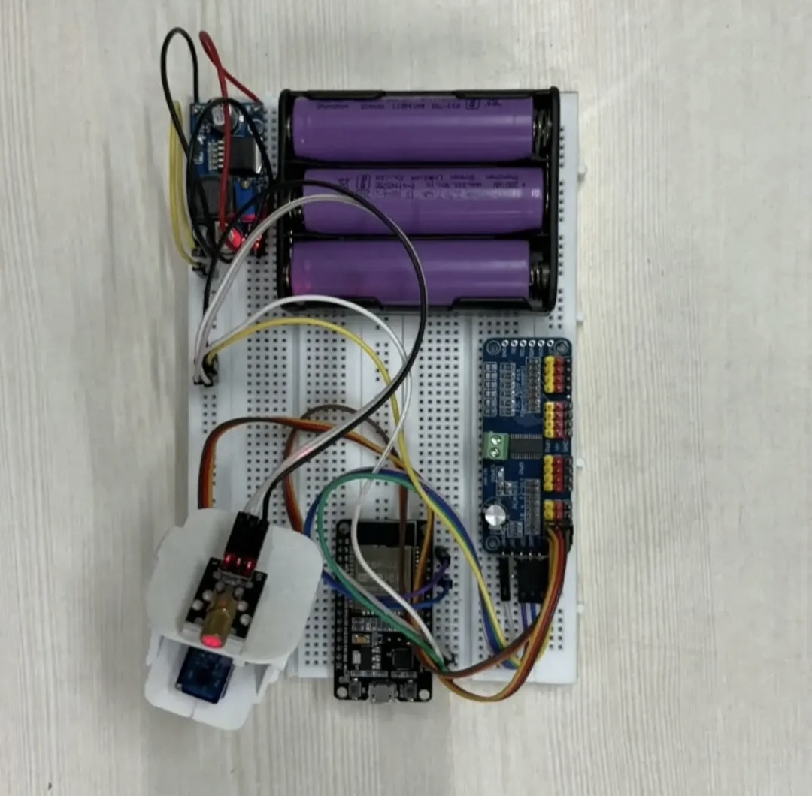
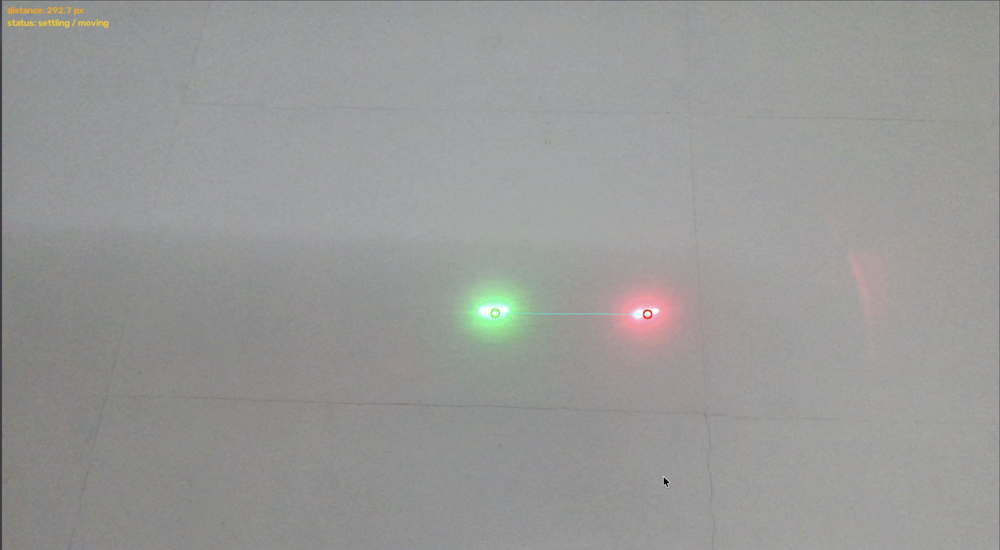

# Laser-Tracking Pan-Tilt Turret

**A computer vision-guided, dual-axis laser tracking prototype built using Python, OpenCV, ESP32, PCA9685, and SG90 servo motors.**


---

## Overview

The Laser-Tracking Pan-Tilt Turret is a computer vision-based robotic system that automatically directs a red laser toward the position of a green laser target.

An external webcam captures the scene, while a Python application uses OpenCV to detect the green laser spot and determine its pixel coordinates. A calibrated pixel-to-servo-angle transformation converts the detected position into pan and tilt commands.

The calculated angles are transmitted to an ESP32 DevKit V1 through USB serial communication. The ESP32 controls a PCA9685 PWM driver over I2C, which drives two SG90 servo motors responsible for positioning the red laser.

The system also detects the red laser spot to evaluate the distance between the commanded laser position and the green target.

**The current implementation uses open-loop control with visual tracking-error measurement.** The detected red laser position is used for evaluating accuracy, not for continuously correcting the motor commands.

This project demonstrates the integration of:

- Computer vision and image processing
- Embedded microcontroller programming
- I2C and serial communication
- Dual-axis servo control
- Camera-to-actuator calibration
- Numerical methods and accuracy evaluation

---


## Project Gallery

### Complete Hardware Setup



ESP32-based dual-axis pan-tilt system using a PCA9685 PWM driver and two SG90 servos.

### Computer Vision Tracking



OpenCV detects the green target and red laser spot for positioning and tracking-error evaluation.


## 🎥 Project Demonstration

Watch the Laser-Tracking Pan-Tilt Turret in action.

[](https://youtu.be/7mieknODzqU)

**[▶ Watch Full Demonstration on YouTube](https://youtu.be/7mieknODzqU)**

### Demonstrated Functionality

- Green laser target detection using OpenCV
- Camera-based target localization
- Automatic pan and tilt servo movement
- ESP32 and PCA9685-based servo control
- Red laser positioning toward the green target


### Demonstration Objectives

- Detect the green target spot using a webcam.
- Determine the target's pixel coordinates.
- Convert the position into calibrated servo angles.
- Transmit angle commands to the ESP32.
- Move the pan-tilt mechanism.
- Detect the red laser position for error measurement.

---

## Key Features

### Computer Vision

- Green and red laser detection using HSV colour segmentation
- Contour-based laser spot localization
- Centroid calculation using image moments
- Morphological operations to reduce detection noise
- Webcam configuration and camera-index selection

### Calibration and Tracking

- Camera pixel-to-servo-angle calibration
- Least-squares fitting of an affine transformation
- Reusable calibration coefficients stored in JSON
- Exponential smoothing of commanded servo angles
- Open-loop target positioning
- Servo angle constraints

### Embedded Control

- ESP32 DevKit V1
- PCA9685 16-channel PWM driver
- Two SG90 servo motors
- I2C communication
- USB serial communication at 115200 baud
- 50 Hz servo PWM frequency

### Performance Analysis

- Red-to-green laser centroid distance
- Mean and median tracking error
- Root Mean Square (RMS) error
- 95th-percentile tracking error
- Maximum recorded error
- Configurable tracking hit threshold
- Optional CSV logging of settled samples

---

## System Architecture

```text
                  Green Laser Target
                          |
                          v
                    USB Webcam
                          |
                          v
                  Python + OpenCV
                          |
                HSV Colour Filtering
                 Contour Detection
                 Centroid Extraction
                          |
                          v
               Pixel-to-Angle Mapping
                          |
                 Command Smoothing
                          |
                          v
                  USB Serial Link
                     115200 baud
                          |
                          v
                    ESP32 DevKit V1
                          |
                       I2C Bus
                          |
                          v
                   PCA9685 Driver
                          |
                   PWM at 50 Hz
                          |
                  +-------+-------+
                  |               |
                  v               v
               Pan Servo       Tilt Servo
                  |               |
                  +-------+-------+
                          |
                          v
                Red Laser Positioning
                          |
                          v
                  Camera Observation
                          |
                          v
                 Accuracy Measurement
               (Red vs Green Position)
```

The red laser detection contributes to the accuracy-analysis branch, not to the tracking-control feedback.

---

## Hardware Components

| Component | Purpose |
|---|---|
| ESP32 DevKit V1 | Receives servo commands and manages PWM driver communication |
| PCA9685 PWM Driver | Generates servo-control PWM signals |
| SG90 Servo Motor × 2 | Pan and tilt actuation |
| External USB Webcam | Captures laser positions |
| Red Laser Module | Servo-mounted laser indicator |
| Green Laser Pointer | Movable visual target |
| External 5V Power Supply | Supplies servo power |
| Connecting Wires | Power and communication connections |

### Hardware Connections

The ESP32 communicates with the PCA9685 using I2C.

| ESP32 / Power Supply | PCA9685 | Description |
|---|---|---|
| ESP32 3V3 | VCC | Logic supply |
| ESP32 GND | GND | Common ground |
| ESP32 GPIO21 | SDA | I2C data |
| ESP32 GPIO22 | SCL | I2C clock |
| External 5V supply + | V+ | Servo power |
| External supply GND | GND | Shared ground |
| PCA9685 Channel 0 | Pan SG90 | Horizontal movement |
| PCA9685 Channel 1 | Tilt SG90 | Vertical movement |

**Important:** The servo supply is provided externally rather than from the ESP32's 3.3V output. The ESP32 and servo power supply must share a common ground.

### Servo Configuration

The firmware initializes the PCA9685 at I2C address `0x40` and sets the PWM frequency to 50 Hz.

| Parameter | Configuration |
|---|---|
| Pan channel | 0 |
| Tilt channel | 1 |
| PWM frequency | 50 Hz |
| Minimum pulse count | 102 |
| Maximum pulse count | 512 |
| Firmware angle limits | 0°–180° |
| Python command limits | 20°–160° by default |

Servo pulse limits may require tuning for the particular motors and mechanical assembly.

---

## Software Architecture

The system is divided into two software components.

### 1. Python Computer Vision Application

The Python program handles:

- Webcam image acquisition
- Laser spot detection
- Calibration data collection
- Pixel-to-angle conversion
- Servo command generation
- Tracking visualization
- Accuracy analysis
- Optional CSV logging

The main libraries are:

| Library | Function |
|---|---|
| OpenCV | Camera acquisition, colour segmentation, visualization |
| NumPy | Numerical calculations and least-squares fitting |
| PySerial | Communication with the ESP32 |

### 2. ESP32 Firmware

The ESP32 acts as a serial-to-PWM controller.

Its responsibilities include:

1. Initialize USB serial communication.
2. Initialize the I2C bus.
3. Configure the PCA9685 PWM driver.
4. Centre both servo motors on startup.
5. Receive comma-separated pan and tilt commands.
6. Convert angles into PWM pulse counts.
7. Update the corresponding PCA9685 channels.

The firmware accepts commands formatted as:

```text
PAN,TILT
```

For example:

```text
97.3,88.1
```

The ESP32 parses the values and updates both servo positions.

---

## Laser Detection Using OpenCV

The Python application detects laser spots using HSV colour segmentation.

### Step 1 — Frame Acquisition

The webcam captures images of the target surface.

Each frame is processed to locate the green target spot and, when visible, the red laser spot.

### Step 2 — HSV Colour Conversion

The captured BGR image is converted into HSV:

```python
hsv = cv2.cvtColor(frame_bgr, cv2.COLOR_BGR2HSV)
```

HSV colour segmentation is used to identify pixels corresponding to each laser colour.

### Step 3 — Colour Thresholding

The implementation uses separate colour thresholds for green and red.

For the red laser, two hue ranges are combined because red occupies both ends of the OpenCV HSV hue range.

### Step 4 — Noise Reduction

Erosion and dilation are applied to the binary mask to suppress small noise regions and improve spot detection.

### Step 5 — Contour Detection

Contours are extracted from the processed mask.

The largest qualifying contour is selected as the detected laser spot.


### Step 6 — Centroid Calculation

Image moments are used to estimate the centre of each detected laser spot.

```math
x_c = \frac{M_{10}}{M_{00}}
```

```math
y_c = \frac{M_{01}}{M_{00}}
```

The resulting coordinates represent the detected spot centre in camera pixel space.


## Camera-to-Servo Calibration

A key part of this project is establishing the relationship between the webcam's pixel coordinates and the pan/tilt servo angles.

Because camera positioning and mechanical geometry affect the mapping, calibration is required before tracking.

### Calibration Procedure

1. Start the calibration application.
2. Manually move the red laser using the keyboard.
3. Record the red laser position and corresponding servo angles.
4. Collect at least six calibration samples distributed across the camera frame.
5. Fit an affine pixel-to-angle mapping using least squares.
6. Save the calculated coefficients to `calibration2.json`.

### Calibration Controls

| Key | Action |
|---|---|
| W | Increase tilt angle |
| S | Decrease tilt angle |
| A | Decrease pan angle |
| D | Increase pan angle |
| Space | Record calibration sample |
| Q | Finish calibration |


### Mathematical Model

The calibration uses an affine transformation.

**Pan angle:**

```math
\theta_{\mathrm{pan}} = a_1x + a_2y + a_3
```

**Tilt angle:**

```math
\theta_{\mathrm{tilt}} = b_1x + b_2y + b_3
```

**Matrix representation:**

```math
\begin{bmatrix}
\theta_{\mathrm{pan}} \\
\theta_{\mathrm{tilt}}
\end{bmatrix}
=
\begin{bmatrix}
a_1 & a_2 & a_3 \\
b_1 & b_2 & b_3
\end{bmatrix}
\begin{bmatrix}
x \\
y \\
1
\end{bmatrix}
```

The coefficients are estimated using NumPy's least-squares solver.

The program also reports the RMS residual of the fitted pan and tilt angle mappings.

**Calibration must be repeated when the camera position or image resolution changes.** The current implementation uses a linear approximation, so accuracy may vary across the working area.

---

## Open-Loop Tracking Algorithm

Once calibration is complete, the application can begin automatic tracking.

### Tracking Workflow

1. Capture a webcam frame.
2. Detect the green laser target.
3. Determine its pixel coordinates.
4. Convert those coordinates into target servo angles.
5. Smooth the target angles.
6. Apply the configured servo-angle limits.
7. Transmit the angles to the ESP32 over USB serial.
8. Drive the pan and tilt servos using the PCA9685.

### Angle Smoothing

To reduce jitter, an exponential smoothing operation is applied to the commanded angles.

To reduce jitter, an exponential smoothing operation is applied to the commanded angles.

```math
\theta_{\mathrm{smooth},k}
=
\alpha\theta_{\mathrm{target},k}
+
(1-\alpha)\theta_{\mathrm{smooth},k-1}
```

The implementation uses:

```math
\alpha = 0.35
```
This reduces rapid command fluctuations caused by small variations in detected pixel coordinates.

The smoothing implementation is a fixed-coefficient exponential filter, rather than a full adaptive One Euro Filter.

### Open-Loop Control

The system calculates servo commands directly from the calibrated mapping.

The red laser is detected to quantify the difference between its observed position and the target, but this measured difference is not used to update the servo commands.

---

## Tracking Accuracy Evaluation

The application includes a quantitative tracking-error measurement system.


### Error Calculation

Tracking error is measured as the Euclidean distance between the red and green laser centroids:

```math
e_{\mathrm{px}} = \sqrt{(x_g-x_r)^2 + (y_g-y_r)^2}
```

Where:

- `x_g, y_g`: Green target centroid coordinates
- `x_r, y_r`: Red laser centroid coordinates
- `e_px`: Tracking error in pixels

An optional measured scale factor can convert this distance into millimetres:

```math
e_{\mathrm{mm}} = e_{\mathrm{px}} \times s
```

Where:

- `s`: Calibrated millimetres-per-pixel scale at the target plane
- `e_mm`: Tracking error in millimetres


### Accuracy Metrics

The application calculates:

| Metric | Description |
|---|---|
| Mean error | Average tracking error |
| Median error | Median tracking error |
| RMS error | Root mean square of tracking error |
| 95th percentile | Error below which 95% of recorded samples fall |
| Maximum error | Largest observed tracking error |
| Hit rate | Percentage of samples within a specified error threshold |

### Settling Detection

Accuracy samples are recorded only after the green target has remained sufficiently stationary.

The current defaults are:

- Stationary movement threshold: 2 pixels per frame
- Settling requirement: 15 consecutive frames
- Hit threshold: 10 pixels

These parameters can be adjusted for different test conditions.

### CSV Accuracy Logging

The tracking program optionally exports measurements containing:

```text
time_s
green_x
green_y
red_x
red_y
distance_px
distance_mm
```

This enables offline analysis of tracking behaviour and measurement accuracy.

Actual accuracy values depend on the hardware setup, camera position, calibration quality, and test conditions. No fixed performance claim is made without measured results.

---

## Installation and Setup

### Prerequisites

**Hardware**
- ESP32 DevKit V1
- PCA9685 PWM driver
- Two SG90 servo motors
- Red laser module and green laser pointer
- External webcam
- External servo power supply
- USB cable

**Software**
- Python 3
- Arduino IDE
- ESP32 board support package
- Adafruit PWM Servo Driver Library

### 1. Upload ESP32 Firmware

Open the Arduino firmware:

`esp32-firmware/esp32_pca9685_bridge.ino`

Install the Adafruit PWM Servo Driver Library using Arduino IDE's Library Manager.

Select the appropriate ESP32 board and serial port, then compile and upload the firmware.

### 2. Install Python Dependencies

Clone or download this repository.

From the repository root:

```bash
pip install -r python/requirements.txt
```

The required Python packages are:

```text
opencv-python
numpy
pyserial
```

### 3. Identify the Camera

```bash
python python/laser_main.py --list-cams
```

The application previews available cameras to help identify the correct device index.

### 4. Calibrate the System

```bash
python python/laser_main.py --calibrate --port /dev/cu.usbserial-XXXX --cam 1
```

Replace the serial port and camera index with the values appropriate to your setup.

Use the calibration controls to collect at least six samples, then press Q to save the calibration.

The program writes `calibration2.json` to the current working directory.

### 5. Start Tracking

```bash
python python/laser_main.py --track --port /dev/cu.usbserial-XXXX --cam 1
```

The application begins detecting the green laser and commanding the pan-tilt assembly.

### 6. Enable Accuracy Logging

```bash
python python/laser_main.py --track --port /dev/cu.usbserial-XXXX --cam 1 --log tracking_results.csv
```

### Optional Tracking Parameters

| Argument | Purpose |
|---|---|
| `--cam` | Camera index |
| `--width` | Requested frame width |
| `--height` | Requested frame height |
| `--fps` | Requested frame rate |
| `--mm-per-px` | Measured distance scale |
| `--hit-px` | Hit threshold in pixels |
| `--settle-frames` | Required stationary frames |
| `--log` | Output CSV path |
| `--auto-exposure` | Retain camera automatic exposure |

### Tracking Controls

| Key | Action |
|---|---|
| R | Reset accuracy statistics |
| Q | Quit and print accuracy summary |

---

## Repository Structure

```text
Laser-Tracking-Pan-Tilt-Turret/
│
├── esp32-firmware/
│   └── esp32_pca9685_bridge.ino
│
├── python/
│   ├── laser_main.py
│   └── requirements.txt
│
├── .gitignore
└── README.md
```

Additional demonstration images, videos, and measurement results can be included as the project documentation develops.

---

## Current Limitations

- The control strategy is open-loop; measured red-to-green tracking error is not used for feedback correction.
- The camera-to-servo mapping is an affine approximation and may not represent nonlinear mechanical behaviour.
- Tracking quality depends on lighting, camera exposure, laser visibility, and calibration.
- Calibration is specific to the camera position and resolution.
- Servo backlash, mechanical alignment, and mounting flexibility can affect positioning.
- The current system requires a connected computer for image processing and command generation.
- Absolute physical tracking error requires an independently measured pixel-to-distance conversion.

---

## Future Improvements

- Closed-loop visual servo control using red-to-green position error
- Improved camera calibration and nonlinear mapping
- Reduced image-processing and actuation latency
- Better compensation for servo backlash and mechanical misalignment
- Adaptive filtering for smoother tracking
- Automated calibration routines
- Expanded experimental tracking datasets and performance analysis

---

## Laser Safety

This project uses visible laser sources. Operate only in a controlled environment with suitable low-power lasers and an appropriate beam stop.

- Never aim lasers toward people or animals.
- Avoid reflective surfaces and uncontrolled beam paths.
- Never direct beams toward vehicles or aircraft.
- Use equipment and operating procedures appropriate to the laser classification.

This prototype is intended for controlled engineering experimentation.

---

## Author

**Asad Tanveer**

Electronics and Communication Engineering  
Jamia Millia Islamia, New Delhi

[GitHub](https://github.com/mirzasadbaig) | [LinkedIn](https://linkedin.com/in/asadtanveer1109)

---

*An embedded systems and computer vision project exploring the integration of camera-based target localization, microcontroller communication, and dual-axis robotic positioning.*
